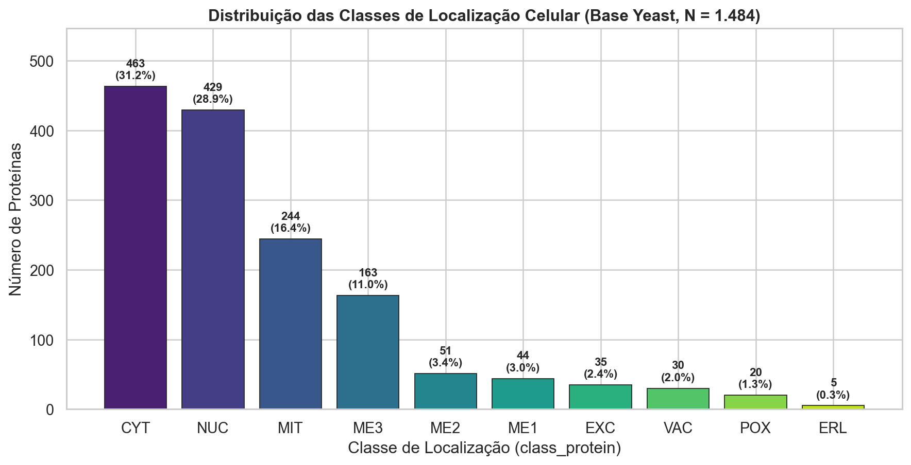
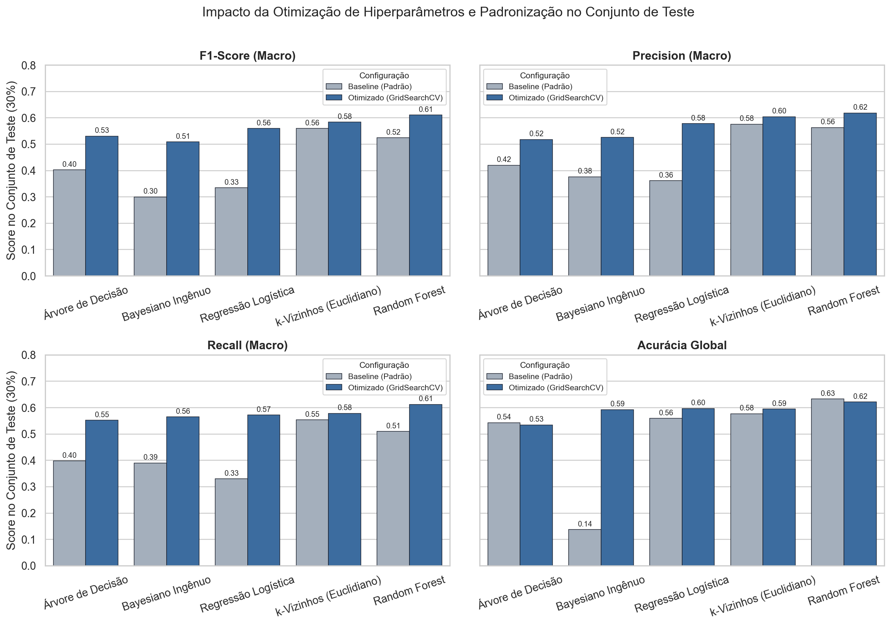
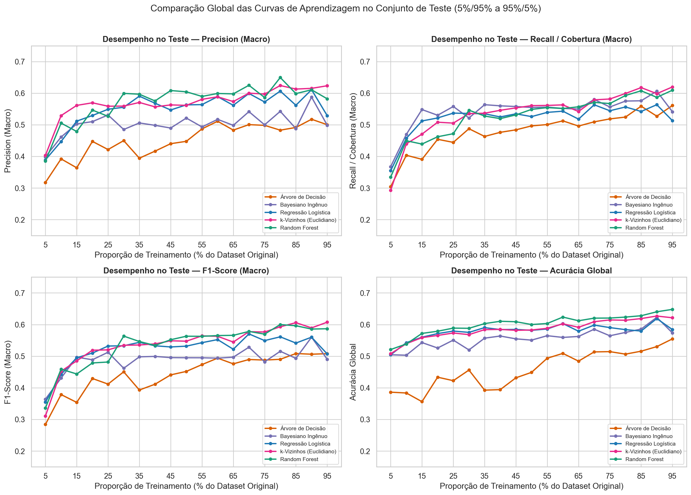

# Yeast Protein Localization Classifiers

Comparative study of five supervised machine learning classifiers applied to the UCI **Yeast** dataset to predict the subcellular localization site of *Saccharomyces cerevisiae* proteins from biochemical and sequence-recognition features.

Developed for the **Machine Learning** course (2025.2) at Centro de Informática, Universidade Federal de Pernambuco (**CIn/UFPE**), advised by Prof. Francisco de A. T. de Carvalho.

---

## Problem & Dataset

The UCI Yeast dataset contains **1,484 protein instances** described by **8 continuous/binary predictive features** with zero missing values. Each protein belongs to one of **10 subcellular localization classes**, exhibiting severe class imbalance (`92.6 : 1` ratio between `CYT` with 463 samples and `ERL` with only 5 samples).

- **Source:** [UCI Machine Learning Repository — Yeast (Dataset #110)](https://archive.ics.uci.edu/dataset/110/yeast) (created by Kenta Nakai, donated by Paul Horton)
- **Predictive Features (8):** `mcg`, `gvh`, `alm`, `mit`, `erl`, `pox`, `vac`, `nuc`
- **Target (`class_protein`, 10 classes):** `CYT` (463), `NUC` (429), `MIT` (244), `ME3` (163), `ME2` (51), `ME1` (44), `EXC` (35), `VAC` (30), `POX` (20), `ERL` (5)



---

## Experimental Methodology

The pipeline follows a strict, leakage-free experimental protocol aligned with the [course project specification](docs/project-brief.pdf):

1. **Exploratory Data Analysis (EDA):** Class imbalance assessment, univariate feature distributions with KDE, per-class boxplots across all 8 predictors, and Pearson correlation analysis (`mcg` vs. `gvh`, $r = 0.58$).
2. **Stratified Hold-Out Split (70% / 30%):** 1,038 samples for training + cross-validation and 446 strictly held-out test samples (`stratify=y, random_state=42`). The test set is never used during scaling or hyperparameter tuning.
3. **Leakage-Free Preprocessing & Cross-Validation:** Feature standardization (`StandardScaler`) is encapsulated inside a `scikit-learn` `Pipeline` together with each classifier and tuned via `GridSearchCV` (`scoring='f1_macro'`) using 3-fold `StratifiedKFold` (ensuring all 10 classes, including `ERL` with 3 training samples, appear in every validation fold).
4. **Five Supervised Classifiers Compared (Baseline vs. Tuned):**
   - **Decision Tree** (`DecisionTreeClassifier`)
   - **Gaussian Naive Bayes** (`GaussianNB`, tuning variance regularization `var_smoothing`)
   - **Multinomial Logistic Regression** (`LogisticRegression`)
   - **k-Nearest Neighbors** (`KNeighborsClassifier` with **Euclidean distance**, $k$ and distance weighting selected via validation)
   - **Random Forest** (`RandomForestClassifier`)
5. **Multi-Metric Evaluation:** Precision, Recall, and F1-Score (Macro and Weighted) alongside global Accuracy and per-class confusion matrices on the 30% test set.
6. **Stratified Learning Curves `(5%, 95%)` to `(95%, 5%)`:** Each best-tuned pipeline is evaluated across complementary `(train, test)` stratified splits from `(5%, 95%)` to `(95%, 5%)` of the full dataset in **5% increments** (19 proportions × 5 stratified repeats), computing Precision, Recall, and F1-Score on both training and test partitions.

---

## Summary of Results (30% Held-Out Test Set, $N = 446$)

| Classifier | Selected Hyperparameters (CV) | CV F1-Macro | Test Accuracy | Precision (Macro) | Recall (Macro) | F1-Score (Macro) | F1-Score (Weighted) |
| :--- | :--- | :---: | :---: | :---: | :---: | :---: | :---: |
| **Decision Tree** | `entropy`, `max_depth=5`, `class_weight='balanced'` | 0.4925 | 53.36% | 0.5171 | 0.5518 | 0.5301 | 0.5292 |
| **Gaussian Naive Bayes** | `var_smoothing=0.3107` | 0.4929 | 59.19% | 0.5249 | 0.5641 | 0.5080 | 0.5799 |
| **Logistic Regression** | `C=100.0`, `solver='lbfgs'` | 0.5218 | 59.64% | 0.5773 | 0.5710 | 0.5594 | 0.5836 |
| **k-Nearest Neighbors** | `metric='euclidean'`, `k=11`, `weights='distance'` | 0.5667 | 59.42% | 0.6036 | 0.5779 | 0.5830 | 0.5836 |
| **Random Forest** | `n_estimators=200`, `max_depth=12`, `class_weight='balanced'` | 0.5574 | **62.11%** | **0.6179** | **0.6121** | **0.6097** | **0.6115** |

### Key Findings
- **Random Forest** achieved the strongest overall performance across every metric (**62.11% accuracy**, **0.6179 macro precision**, **0.6121 macro recall**, and **0.6097 macro F1**), improving macro F1 by **+8.6 pp** over its untuned baseline (`0.5237`).
- **Euclidean k-NN ($k = 11$, distance-weighted)** ranked second in macro F1 (**0.5830**) and macro precision (**0.6036**), preventing rare classes such as `ERL` from being outvoted in larger neighborhoods.
- **Tuning `var_smoothing` rescued Gaussian Naive Bayes:** With default `var_smoothing=1e-9`, near-constant sparse features (`erl`, `pox`) have zero within-class sample variance in minority classes, producing degenerate Gaussian density spikes that collapse accuracy to **13.68%** (12.1% on pre-scaled inputs). Cross-validated variance smoothing (`var_smoothing ≈ 0.31`) lifted test accuracy to **59.19%** (+45.5 pp) and macro F1 from `0.2990` to `0.5080`.
- **Dominant Error Mode:** Confusion matrices show that residual misclassifications across all five models stem primarily from biochemical overlap between cytosolic (`CYT`) and nuclear (`NUC`) proteins, as well as the ambiguous vacuolar (`VAC`) class.





---

## Repository Layout

```text
.
├── README.md                              # Project overview, methodology, and results
├── requirements.txt                       # Python dependencies
├── run_experiments.py                     # Reproducible CLI pipeline (generates CSV/JSON + PNG figures)
├── data/
│   ├── yeast.data                         # Extracted UCI Yeast dataset (1,484 samples)
│   ├── yeast.names                        # Original UCI metadata and attribute descriptions
│   └── yeast-datasets.zip                 # Archived copy of the dataset
├── src/
│   ├── __init__.py
│   ├── data.py                            # Portable dataset loader and stratified split utilities
│   ├── models.py                          # Baseline & Pipeline+GridSearchCV definitions for all 5 models
│   ├── evaluation.py                      # Multi-class metrics & (5%,95%)..(95%,5%) learning curves
│   └── plotting.py                        # High-resolution Matplotlib/Seaborn visualizations
├── notebooks/
│   └── yeast_classification.ipynb         # Self-contained, executed Jupyter Notebook (local & Colab ready)
├── results/
│   ├── baseline_vs_tuned_metrics.csv      # Baseline vs. tuned evaluation summary
│   ├── per_class_metrics.csv              # Per-class precision, recall, F1, and support
│   ├── knn_validation_curve.csv           # Cross-validation scores across k for Euclidean k-NN
│   ├── learning_curves_metrics.csv        # Train & test metrics from (5%,95%) to (95%,5%)
│   ├── best_hyperparameters.json          # Selected hyperparameters and test scores
│   └── figures/                           # Exported publication-ready charts (PNG)
├── docs/
│   ├── relatorio.md                       # Complete technical report (in Portuguese)
│   ├── project-brief.pdf                  # Original CIn/UFPE course assignment
│   └── presentation.pdf                   # Course presentation slides
└── tests/
    └── test_pipeline.py                   # Automated pytest verification suite
```

---

## How to Run

### 1. Install Dependencies
Requires Python 3.10+:

```bash
pip install -r requirements.txt
```

### 2. Run the Reproducible Experimental Pipeline (CLI)
Regenerates all CSV/JSON tables and high-resolution figures under `results/`:

```bash
python run_experiments.py
```

### 3. Explore or Run the Jupyter Notebook
The notebook automatically resolves `data/yeast.data` (or `data/yeast-datasets.zip`) both locally and in Google Colab without manual path edits:

```bash
jupyter notebook notebooks/yeast_classification.ipynb
```

### 4. Run Automated Tests
```bash
pytest -v
```

---

## Authors

- Andreywid Yago Lima de Souza
- Artur Vinícius Pereira Fernandes
- Heitor Higino Holanda Cordeiro
- Arthur Thierre Dos Santos Silva

Centro de Informática (CIn), Universidade Federal de Pernambuco (UFPE).

## References

- Horton, P. & Nakai, K. (1996). *A Probabilistic Classification System for Predicting the Cellular Localization Sites of Proteins.* Intelligent Systems in Molecular Biology (ISMB), 109–115. UCI Machine Learning Repository.
- Pedregosa, F. et al. (2011). *Scikit-learn: Machine Learning in Python.* Journal of Machine Learning Research, 12, 2825–2830.
