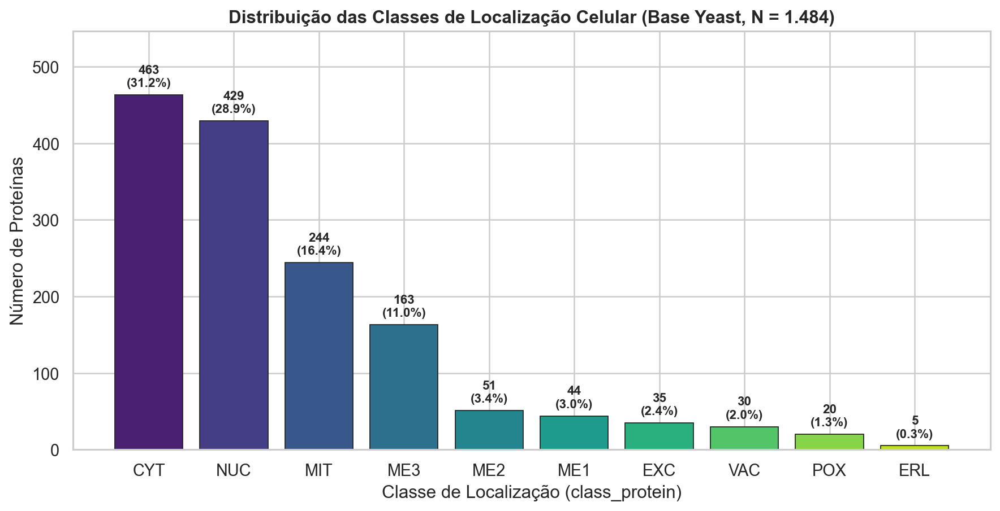
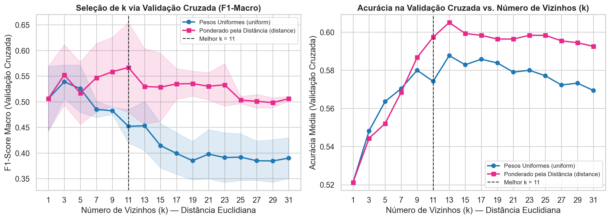
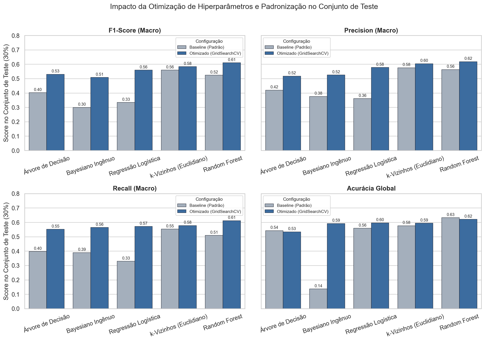
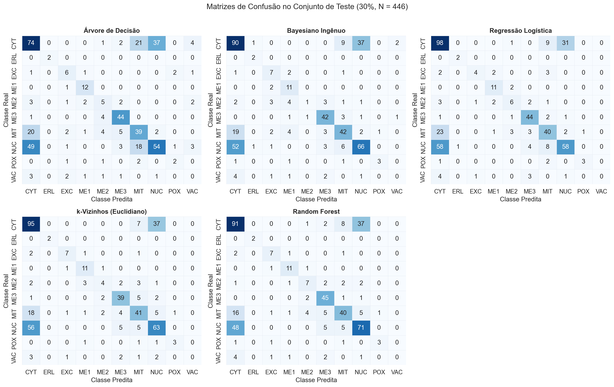
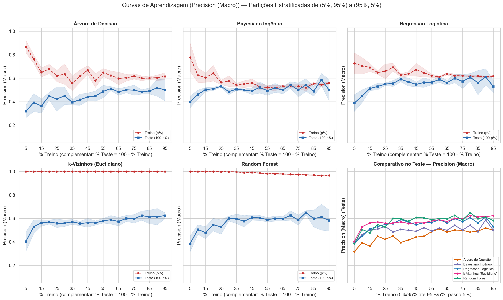
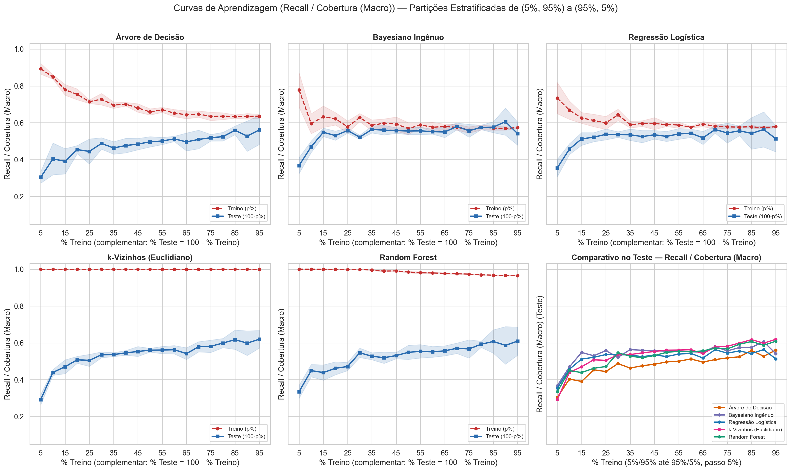
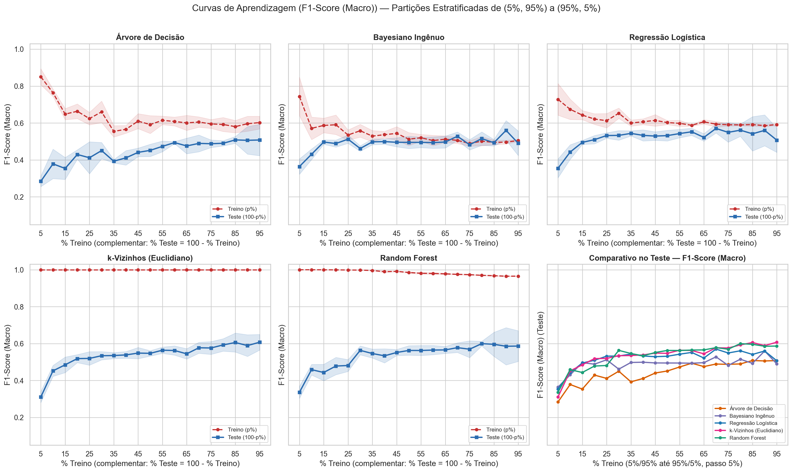
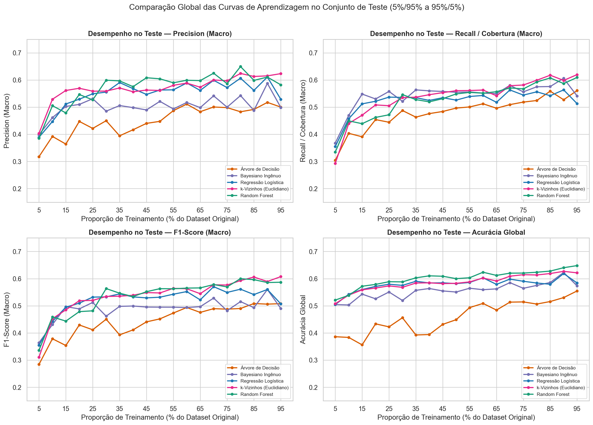

# Relatório Técnico — Classificação da Localização Celular de Proteínas de Levedura (*Yeast*)

**Disciplina:** Aprendizado de Máquina (2025.2) — Centro de Informática (CIn / UFPE)  
**Docente:** Prof. Francisco de A. T. de Carvalho  
**Autores:**
- Andreywid Yago Lima de Souza
- Artur Vinícius Pereira Fernandes
- Heitor Higino Holanda Cordeiro
- Arthur Thierre Dos Santos Silva

---

## 1. Descrição Sucinta da Base de Dados

A base de dados **Yeast** (*Protein Localization Sites*), elaborada por Kenta Nakai (Universidade de Osaka) e doada por Paul Horton ao *UCI Machine Learning Repository* ([UCI #110](https://archive.ics.uci.edu/dataset/110/yeast)), compreende **1.484 instâncias** de proteínas da levedura *Saccharomyces cerevisiae*, sem valores ausentes (`0` *missing values*).

Após a remoção do identificador textual não preditivo `sequence_name` (código de acesso no banco SWISS-PROT), cada proteína é representada por **8 atributos numéricos preditivos** derivados de métodos bioquímicos e análises discriminantes de sequência:

| Atributo | Intervalo Observado | Média ± DP | Descrição |
| :--- | :---: | :---: | :--- |
| `mcg` | `[0.11, 1.00]` | `0.5001 ± 0.1373` | Método de McGeoch para reconhecimento de sequência sinal |
| `gvh` | `[0.13, 1.00]` | `0.4999 ± 0.1239` | Método de von Heijne para reconhecimento de sequência sinal |
| `alm` | `[0.21, 1.00]` | `0.5000 ± 0.0867` | Pontuação ALOM de predição de região transmembranar |
| `mit` | `[0.00, 1.00]` | `0.2611 ± 0.1371` | Análise discriminante de aminoácidos N-terminal (proteínas mitocondriais) |
| `erl` | `{0.50, 1.00}` | `0.5047 ± 0.0484` | Presença do motivo `"HDEL"` de retenção no lúmen do RE (binário) |
| `pox` | `[0.00, 0.83]` | `0.0075 ± 0.0757` | Sinal de direcionamento peroxissomal no C-terminal |
| `vac` | `[0.00, 0.73]` | `0.4999 ± 0.0578` | Análise discriminante de proteínas vacuolares e extracelulares |
| `nuc` | `[0.00, 1.00]` | `0.2762 ± 0.1065` | Análise discriminante de sinais de localização nuclear |

A variável-alvo (`class_protein`) divide as proteínas em **10 sítios de localização subcelular** com **severo desbalanceamento de classes** (razão máxima `92,6 : 1` entre `CYT` e `ERL`):

- **Classes majoritárias (87,5% da base):** `CYT` (463; 31,20%), `NUC` (429; 28,91%), `MIT` (244; 16,44%) e `ME3` (163; 10,98%).
- **Classes intermediárias e minoritárias (12,5% da base):** `ME2` (51; 3,44%), `ME1` (44; 2,96%), `EXC` (35; 2,36%), `VAC` (30; 2,02%), `POX` (20; 1,35%) e `ERL` (5; 0,34%).

A análise exploratória bivariada e de correlação evidenciou ainda:
1. **Correlação positiva moderada ($r = 0{,}58$) entre `mcg` e `gvh`**, ambos voltados à detecção de peptídeos-sinal N-terminais;
2. **Atributos quase constantes por classe (`erl` e `pox`)**: em diversas classes (`VAC`, `ME2`, `ME3`), 100% dos exemplos assumem `erl = 0.5` e `pox = 0.0` (variância intraclasse nula);
3. **Forte sobreposição entre `CYT` e `NUC`** em quase todos os atributos preditivos, impondo um limite Bayesiano natural à separabilidade perfeita.

---

## 2. Organização Experimental e Prevenção de Vazamento de Dados

Para garantir uma avaliação imparcial e metodologicamente rigorosa entre os **5 classificadores exigidos**:

1. **Particionamento Estratificado (70% / 30%):** A base original (`N = 1.484`) foi dividida de maneira aleatória e estratificada (`train_test_split(..., test_size=0.30, stratify=y, random_state=42)`) em:
   - **Conjunto de Treinamento + Validação:** `1.038` amostras (70%), contendo todas as 10 classes (`CYT=324, NUC=300, MIT=171, ME3=114, ME2=36, ME1=31, EXC=24, VAC=21, POX=14, ERL=3`);
   - **Conjunto de Teste (Retido):** `446` amostras (30%), mantido **integralmente isolado** durante todo o ajuste de pré-processamento e busca de hiperparâmetros.
2. **Encapsulamento em `Pipeline` (`StandardScaler` + Classificador):** A padronização para média zero e variância unitária (`StandardScaler`) é executada **dentro** do `Pipeline` em cada dobra de validação cruzada. Dessa forma, as estatísticas das dobras de validação e do conjunto de teste jamais vazam para o treinamento.
3. **Validação Cruzada Estratificada de 3 Dobras (`StratifiedKFold(n_splits=3, shuffle=True, random_state=42)`):** Como a classe minoritária `ERL` possui exatamente **3 instâncias** no conjunto de treino (70%), o uso de $k = 3$ dobras estratificadas assegura que **todas as 10 classes estejam presentes em cada dobra de validação**, tornando a métrica de seleção (`f1_macro`) bem-definida e comparável entre dobras.
4. **Métricas de Avaliação:** Avaliamos **Precision (Precisão)**, **Recall (Cobertura)** e **F1-Score** — com foco na agregação **Macro** (que atribui peso idêntico às 10 classes, penalizando modelos que ignoram classes raras) acompanhada da agregação **Ponderada (*Weighted*)** e da **Acurácia Global**.

---

## 3. Detalhes da Obtenção dos Hiperparâmetros por Modelo

A busca exaustiva (`GridSearchCV`, critério `scoring='f1_macro'`) foi conduzida exclusivamente sobre os 70% de treinamento para os cinco algoritmos:

| Classificador | Espaço de Busca Avaliado | Melhor Configuração Selecionada (CV) | F1-Macro (CV) |
| :--- | :--- | :--- | :---: |
| **1. Árvore de Decisão** | `criterion`: `{gini, entropy}` `max_depth`: `{None, 5, 7, 9, 12}` `min_samples_split`: `{2, 5, 10}` `min_samples_leaf`: `{1, 2, 4}` `ccp_alpha`: `{0.0, 0.003}` `class_weight`: `{None, balanced}` | `criterion='entropy'`, `max_depth=5`, `min_samples_split=2`, `min_samples_leaf=1`, `ccp_alpha=0.0`, `class_weight='balanced'` | `0.4925` |
| **2. Bayesiano Ingênuo (`GaussianNB`)** | `var_smoothing`: 40 valores em escala logarítmica de `10⁻⁹` a `10⁰·²` | `var_smoothing = 0.3107` | `0.4929` |
| **3. Regressão Logística** | `C`: `{0.01, 0.1, 0.5, 1, 2, 5, 10, 50, 100}` `solver`: `{lbfgs, newton-cg}` `class_weight`: `{None, balanced}` | `C=100.0`, `solver='lbfgs'`, `class_weight=None` | `0.5218` |
| **4. k-Vizinhos (`metric='euclidean'`)** | `n_neighbors (k)`: `{1, 3, 5, ..., 31}` `weights`: `{uniform, distance}` | `n_neighbors=11`, `weights='distance'`, `metric='euclidean'` | `0.5667` |
| **5. Random Forest** | `n_estimators`: `{100, 200}` `max_depth`: `{None, 8, 10, 12}` `min_samples_split`: `{2, 8}` `min_samples_leaf`: `{1, 2}` `class_weight`: `{None, balanced}` | `n_estimators=200`, `max_depth=12`, `min_samples_split=2`, `min_samples_leaf=1`, `class_weight='balanced'` | `0.5574` |

### Destaques Técnicos da Seleção de Hiperparâmetros
- **Escolha de $k$ no k-NN com Distância Euclidiana:** Conforme ilustrado abaixo, na votação uniforme (`weights='uniform'`), valores $k \ge 7$ degradam abruptamente o `F1-Macro` porque a classe `ERL` possui apenas 3 exemplos no treino — tornando impossível vencer por maioria simples em vizinhanças amplas. Já a ponderação pelo inverso da distância Euclidiana (`weights='distance'`) preserva a influência de vizinhos muito próximos mesmo em $k = 11$, atingindo o ótimo de validação (`F1-Macro = 0.5667`).

- **Recuperação do Bayesiano Ingênuo via `var_smoothing`:** Com o valor padrão `var_smoothing = 1e-9`, classes raras cuja amostra de treino tem variância zero em `erl` e `pox` produzem densidades Gaussianas degeneradas ($\sigma^2 \approx 10^{-9}$) que dominam a verossimilhança, derrubando a acurácia para **13,7%** (12,1% com dados pré-escalados). A seleção de `var_smoothing ≈ 0.31` por validação cruzada regulariza as variâncias intraclasse e eleva a acurácia no teste para **59,2%**.

---

## 4. Avaliação e Comparação dos Classificadores no Conjunto de Teste (30%)

A tabela a seguir confronta o desempenho **Baseline (hiperparâmetros padrão)** e **Otimizado (`Pipeline` + `GridSearchCV`)** no conjunto de teste retido (`446` proteínas):

| Classificador | Etapa | Acurácia | Precision (Macro) | Recall (Macro) | F1-Score (Macro) | F1-Score (Weighted) |
| :--- | :--- | :---: | :---: | :---: | :---: | :---: |
| **Árvore de Decisão** | Baseline | 0.5426 | 0.4193 | 0.3972 | 0.4017 | 0.5394 |
| **Árvore de Decisão** | **Otimizado** | **0.5336** | **0.5171** | **0.5518** | **0.5301** | **0.5292** |
| **Bayesiano Ingênuo** | Baseline | 0.1368 | 0.3760 | 0.3893 | 0.2990 | 0.1545 |
| **Bayesiano Ingênuo** | **Otimizado** | **0.5919** | **0.5249** | **0.5641** | **0.5080** | **0.5799** |
| **Regressão Logística** | Baseline | 0.5583 | 0.3605 | 0.3292 | 0.3343 | 0.5315 |
| **Regressão Logística** | **Otimizado** | **0.5964** | **0.5773** | **0.5710** | **0.5594** | **0.5836** |
| **k-Vizinhos (Euclidiano)** | Baseline | 0.5762 | 0.5754 | 0.5527 | 0.5587 | 0.5686 |
| **k-Vizinhos (Euclidiano)** | **Otimizado** | **0.5942** | **0.6036** | **0.5779** | **0.5830** | **0.5836** |
| **Random Forest** | Baseline | 0.6323 | 0.5627 | 0.5089 | 0.5237 | 0.6219 |
| **Random Forest** | **Otimizado** | **0.6211** | **0.6179** | **0.6121** | **0.6097** | **0.6115** |

### Análise Comparativa e Matrizes de Confusão
1. **Superioridade Global do Random Forest:** O Random Forest otimizado alcança o melhor equilíbrio em todas as métricas exigidas: **Acurácia de 62,11%**, **Precision Macro de 61,79%**, **Recall Macro de 61,21%** e **F1-Score Macro de 60,97%** (ganho de +8,6 p.p. em F1-Macro sobre o Random Forest padrão).
2. **Competitividade do k-NN Euclidiano ($k=11$, `distance`):** Ocupa a segunda colocação geral em F1-Macro (**0,5830**) e Precision Macro (**0,6036**), demonstrando que a geometria local no espaço padronizado captura bem os agrupamentos subcelulares.
3. **Ganhos Expressivos na Regressão Logística e no Bayesiano Ingênuo:** A otimização elevou o F1-Macro da Regressão Logística de `0,3343` para `0,5594` (+22,5 p.p.) e do Bayesiano Ingênuo de `0,2990` para `0,5080` (+20,9 p.p., com salto de +45,5 p.p. em acurácia).
4. **Padrão de Erros por Classe:** As matrizes de confusão revelam que a maior parcela de erros decorre da sobreposição biológica entre proteínas citosólicas (`CYT`) e nucleares (`NUC`), bem como da baixíssima separabilidade da classe vacuolar (`VAC`, 9 amostras no teste), enquanto `ERL`, `ME3`, `ME1` e `EXC` são reconhecidas com elevada precisão e cobertura pelos modelos não-lineares.

---

## 5. Curvas de Aprendizagem de `(5%, 95%)` a `(95%, 5%)` por Métrica

Seguindo estritamente o protocolo experimental definido no enunciado, cada classificador com sua **melhor configuração de hiperparâmetros** foi avaliado em partições estratificadas `(treinamento, teste)` variando de **(5%, 95%) a (95%, 5%)** da base original com **passo de 5%** (19 proporções, repetidas 5 vezes cada para estimativa de média e desvio-padrão, computando as métricas tanto no conjunto de treino quanto no conjunto de teste).

### 5.1 Precision (Precisão Macro)

### 5.2 Recall / Cobertura (Macro)

### 5.3 F1-Score (Macro)

### 5.4 Painel Comparativo Global no Conjunto de Teste

### Comentários sobre as Curvas de Aprendizagem
1. **Regime de Amostras Reduzidas `(5%, 95%)` a `(20%, 80%)`:** Em 5% de treino ($N_{\text{treino}} = 74$), classes extremamente raras como `ERL` ($5 \times 0{,}05 = 0{,}25$) ficam ausentes da amostra de treinamento e `POX` conta com apenas 1 instância. Isso explica os valores iniciais reduzidos (~0,28–0,36 de F1-Macro no teste) e a inclinação acentuada de ganho entre 5% e 30% de treino em todas as três métricas (**Precision**, **Recall** e **F1-Score**).
2. **Contraste entre Modelos Paramétricos e Não-Paramétricos / Ensembles:**
   - **Bayesiano Ingênuo e Regressão Logística** exibem rápida convergência entre as curvas de treinamento e teste já a partir de 35%–45% dos dados, estabilizando em platôs (~0,50–0,56 de F1-Macro). Esse pequeno *gap* treino-teste indica **baixo sobreajuste, porém maior viés estrutural** (fronteiras lineares / independência condicional).
   - **k-NN (`weights='distance'`) e Random Forest (`max_depth=12`)** mantêm pontuação elevada no conjunto de treinamento (próxima a 1,0 devido à ponderação por distância nula nos pontos de treino e à capacidade das árvores profundas), mas **não sofrem degradação no teste**: pelo contrário, suas curvas de teste crescem continuamente com o aumento da amostra e lideram **Precision, Recall e F1-Score** em praticamente toda a faixa de 30% a 95%.
   - **Árvore de Decisão (`max_depth=5`)** controla o sobreajuste por meio da poda de profundidade, mas exibe maior instabilidade (faixa de desvio-padrão mais ampla) em comparação ao Random Forest, comprovando o benefício da agregação por *bagging*.
3. **Aumento da Variância de Teste no Extremo `(95%, 5%)`:** Quando o treino atinge 90%–95%, o conjunto de teste reduz-se a apenas 75–149 proteínas (com 0 a 1 representante das classes `ERL` e `POX`), elevando naturalmente a variância estatística da estimativa de teste (alargamento das bandas azuis no extremo direito dos gráficos).

---

## 6. Conclusão

O estudo comparativo demonstrou que o tratamento rigoroso de pré-processamento sem vazamento de dados (`Pipeline`), aliado à validação cruzada estratificada compatível com classes raras e à otimização criteriosa de hiperparâmetros, melhora substancialmente a qualidade preditiva dos cinco paradigmas de classificação avaliados. O **Random Forest** destacou-se como o modelo mais eficaz e estável na predição da localização subcelular de proteínas de levedura (**62,1% de acurácia** e **~0,61–0,62 em Precision, Recall e F1-Score Macro**), seguido pelo **k-NN com distância Euclidiana ($k=11$, ponderado pela distância)** e pela **Regressão Logística multinomial**.
